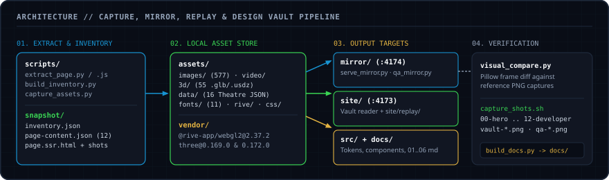
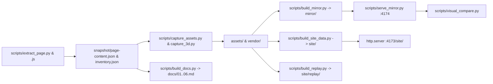

<p align="center">
  
</p>

<p align="center">
  
  
  
  
</p>

Offline front-end architecture study archive, local runnable mirror, and distilled token library extracted from Shopify Editions Winter '26 (`/editions/winter2026`). It packages captured CSS, JavaScript chunks, 3D scenes, Theatre.js state data, and a static vault reader alongside six technical teardown documents.

---

## Table of Contents

- [Overview](#overview)
- [Visual Showcase](#visual-showcase)
- [Architecture and Pipeline](#architecture-and-pipeline)
- [File Structure](#file-structure)
- [Prerequisites](#prerequisites)
- [Installation and Usage](#installation-and-usage)
- [Scope and Limits](#scope-and-limits)
- [License](#license)

---

## Overview

The captured source page renders twelve editorial chapters in a single 46,000+ px scroll document built on Shopify Oxygen, Remix, Tailwind CSS 4.2.2, Rive, Three.js, and Lenis. Rather than leaving those findings scattered in browser DevTools, this repository isolates three artifacts side by side: a local mirror served on its expected route, a searchable archive reader (`site/`), and a clean-room CSS token and component sheet (`src/`) derived from the measured styles.

---

## Visual Showcase

| Vault Reader: Overview | Vault Reader: Design System |
| :---: | :---: |
|  |  |

| Vault Reader: 12 Chapters | Captured Reference: Hero Scene |
| :---: | :---: |
|  |  |

---

## Architecture and Pipeline

<p align="center">
  
</p>



### Pipeline Stages

1. **DOM and resource capture:** `extract_page.py` and `extract_page.js` record route metadata, section copy across 12 chapters, and CDN asset URLs into `snapshot/`.
2. **Asset retrieval:** `capture_assets.py`, `capture_chunks.py`, and `capture_3d.py` download referenced bundles, images, fonts, Theatre.js JSONs, Rive state machines, and `.glb`/`.usdz` models into `assets/` and `vendor/`.
3. **Mirror and replay generation:** `build_mirror.py` and `build_replay.py` rewrite routes for local execution, while `qa_mirror.py` and `visual_compare.py` check rendered screenshots against baseline captures in `snapshot/screenshots/`.
4. **Distillation:** `src/` exposes original CSS custom properties (`shoptify-tokens.css`) and layout primitives (`components.css`, `components.html`) without copying third-party paintings or proprietary assets.

---

## File Structure

| Path | Contents |
| --- | --- |
| `assets/` | Captured bundles across `3d/` (55 files), `data/` (16 Theatre.js state files), `images/` (577 files), `fonts/` (11 files), `css/`, `js/`, `rive/`, `textures/`, `video/`, and `manifest.json` |
| `docs/` | Six teardown reports (`01-teardown.md` through `06-mirror.md`) covering runtime stack, color/type tokens, information architecture, motion, asset ledger, and mirror setup |
| `mirror/` | Local runnable mirror (`index.html`, `css/`, `js/`, and symlinks to `assets` and `vendor`) |
| `scripts/` | 15 Python, Node, and shell utilities for extraction, inventory, mirror assembly, replay generation, local serving, and visual comparison |
| `site/` | Static vault UI (`index.html`, `app.js`, `data.js`, `studio.css`), chapter `.webp` stills (`site/media/`), and `site/replay/` |
| `snapshot/` | `inventory.json`, `page-content.json`, `page.ssr.html`, `capture.log`, and verification screenshots (`snapshot/screenshots/`) |
| `src/` | Clean-room CSS tokens and component library (`shoptify-tokens.css`, `components.css`, `components.html`, `README.md`) |
| `vendor/` | Local copies of `@rive-app/webgl2@2.37.2`, `three@0.169.0`, and `three@0.172.0` |

---

## Prerequisites

- Python 3.10 or newer
- Pillow (`pip install pillow`) for `scripts/visual_compare.py`
- Node.js (optional, only needed when invoking `scripts/extract_page.js` directly)

---

## Installation and Usage

```bash
git clone https://github.com/broamstuck-cybr/shoptify-winter-reverser-engine.git
cd shoptify-winter-reverser-engine
```

Serve the local mirror on port `4174` or launch the static vault reader on port `4173`:

```bash
# Serve the captured mirror on its expected route
python3 scripts/serve_mirror.py 4174

# Serve the static archive vault reader
python3 -m http.server 4173
```

Open `http://127.0.0.1:4174/editions/winter2026` for the mirror, `http://127.0.0.1:4173/site/` for the archive vault, or open `src/components.html` directly to inspect the distilled token sheet.

To rebuild generated inventory, site data, and documentation from captured inputs:

```bash
python3 scripts/build_inventory.py
python3 scripts/capture_assets.py snapshot/inventory.json assets
python3 scripts/build_site_data.py
python3 scripts/build_docs.py
```

---

## Scope and Limits

- Intended strictly for educational front-end architecture, layout token, and motion-timeline study.
- `mirror/assets` and `mirror/vendor` are stored as relative symlinks targeting `./Documents/Study Archive/projects/shoptify/...`; if your checkout does not map that target, run `serve_mirror.py` or adjust those two links to point to `./assets` and `./vendor` at the repository root.
- Third-party paintings, editorial copy, brand fonts, and compiled runtime bundles in `assets/` and `mirror/` remain the property of their respective owners and must not be redistributed as a commercial template.

---

## License

Original study notes, pipeline scripts, and clean-room styles in `src/` are provided for educational reference; no standalone `LICENSE` file is currently present in this repository.
